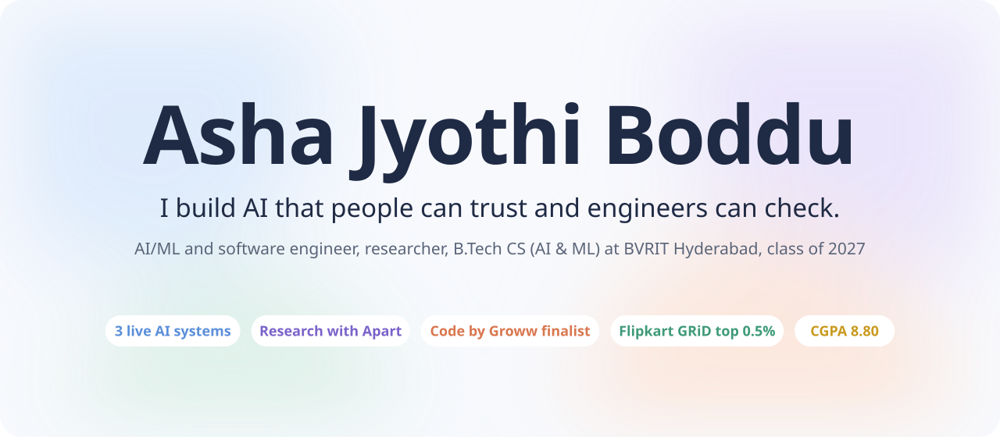
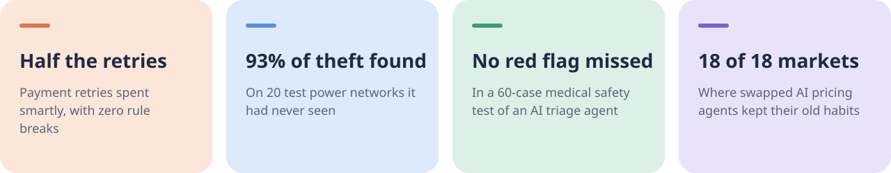
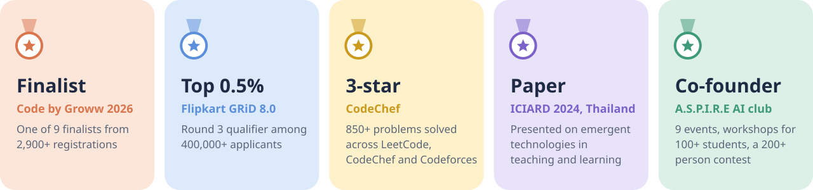

&nbsp;
&nbsp;

 

Hi, I'm Asha. I build AI systems where the decisions that have to be right are made by plain, tested code, and the AI explains them in words people understand. Three of those systems are live below, each with a guided tour, and I recently finished a pre-registered research study with Apart Research.

 

## What I've built

<a href="https://healthai-triage.onrender.com"><b>Try it live</b></a>&nbsp;&nbsp;&nbsp;&nbsp;<a href="https://github.com/Asha0509/HealthCare">Read the code</a>

<a href="https://vidyutdrishti.onrender.com"><b>Try it live</b></a>&nbsp;&nbsp;&nbsp;&nbsp;<a href="https://github.com/Asha0509/VidyutDrishti">Read the code</a>

<a href="https://retry-allocator.onrender.com"><b>Try it live</b></a>&nbsp;&nbsp;&nbsp;&nbsp;<a href="https://github.com/Asha0509/retry-budget-allocator">Read the code</a>

VidyutDrishti and Retry Budget Allocator are tested on simulated networks and payments, so their numbers show how well each system decides, not real-world rates. Each repository explains its setup and what did not work.

 

## Research

<a href="https://github.com/Asha0509/Apart-AI-Collusion-Research-Sprint"><b>Read the study</b></a>

 

## How I got here

 

## Recognition

 

## What I work with

<b>Where each skill shows up in my code</b>

 

| Area | Skills | See it in |
|---|---|---|
| AI and LLMs | Tool-calling agents, RAG with citations, MCP server, provider failover, eval harnesses | [HealthAI](https://github.com/Asha0509/HealthCare), [VidyutDrishti](https://github.com/Asha0509/VidyutDrishti), [NexusDocs](https://github.com/Asha0509/Nexus_Docs) |
| Machine learning | scikit-learn, Isolation Forest, conformal prediction, forecasting, MediaPipe, OpenCV | [VidyutDrishti](https://github.com/Asha0509/VidyutDrishti), [HealthAI](https://github.com/Asha0509/HealthCare), [YogaAlign](https://github.com/Asha0509/YogaAlign) |
| Backend and data | FastAPI, Flask, Spring Boot, Pydantic, Pandera data contracts, SQL databases, ChromaDB | [Retry Allocator](https://github.com/Asha0509/retry-budget-allocator), [VidyutDrishti](https://github.com/Asha0509/VidyutDrishti), [E-commerce API](https://github.com/Asha0509/Ecommerce_FullStack) |
| Quality | pytest, Hypothesis property tests, mutation testing, CI eval gates, CodeQL | [Retry Allocator](https://github.com/Asha0509/retry-budget-allocator), [HealthAI](https://github.com/Asha0509/HealthCare), [VidyutDrishti](https://github.com/Asha0509/VidyutDrishti) |
| Frontend | React, TypeScript, Next.js, Tailwind CSS, TanStack Query | [VidyutDrishti](https://github.com/Asha0509/VidyutDrishti), [NexusDocs](https://github.com/Asha0509/Nexus_Docs) |
| Research | Pre-registered experiments, multi-agent LLM simulation | [Model-swap study](https://github.com/Asha0509/Apart-AI-Collusion-Research-Sprint) |

 

## More things I've built

- **[NexusDocs](https://github.com/Asha0509/Nexus_Docs)**: chat with your PDFs and notes, and every answer shows the passage it came from.
- **[YogaAlign](https://github.com/Asha0509/YogaAlign)**: recognises 6 yoga poses from a video or your webcam (built during my AptPath internship).
- **[Since](https://github.com/Asha0509/Groww_Hackathon)**: a smart market watchlist, my Code by Groww 2026 finalist project.
- **[A2S, Aesthetics To Spaces](https://github.com/AestheticsToSpaces/A2S_Beta)**: an AI interior-design platform with a multi-agent system and 28,000+ products.
- **[Multi-tenant e-commerce API](https://github.com/Asha0509/Ecommerce_FullStack)**: a Spring Boot backend for a multi-seller store with carts, orders and payments.

 

### Let's talk

I'm looking for AI/ML and SDE internships, and I'm always happy to talk research.

&nbsp;
&nbsp;

