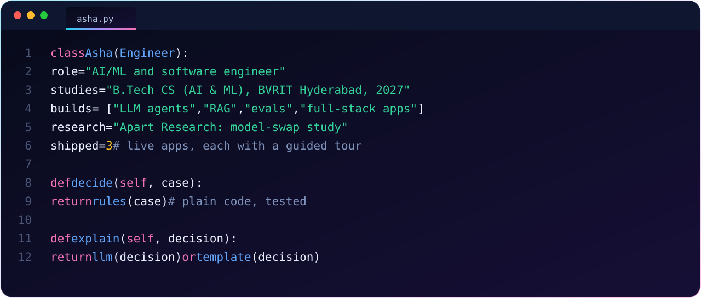
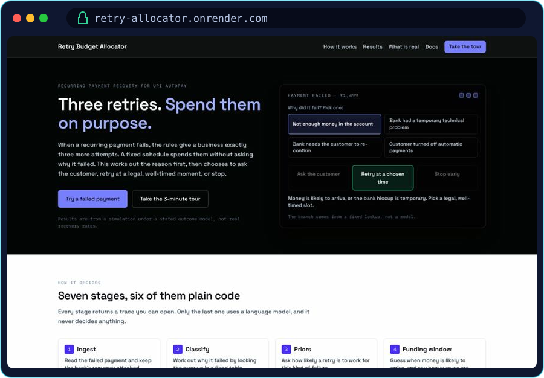
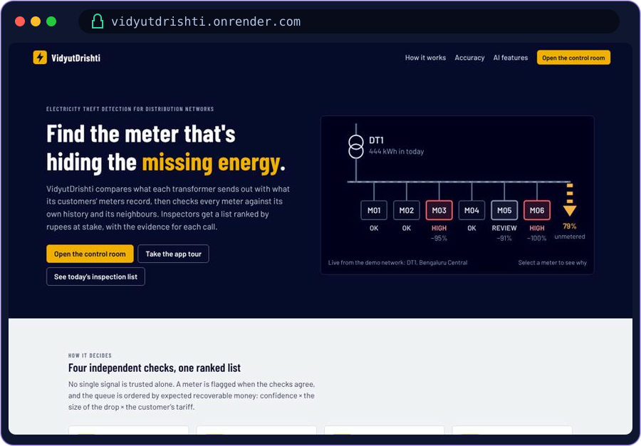
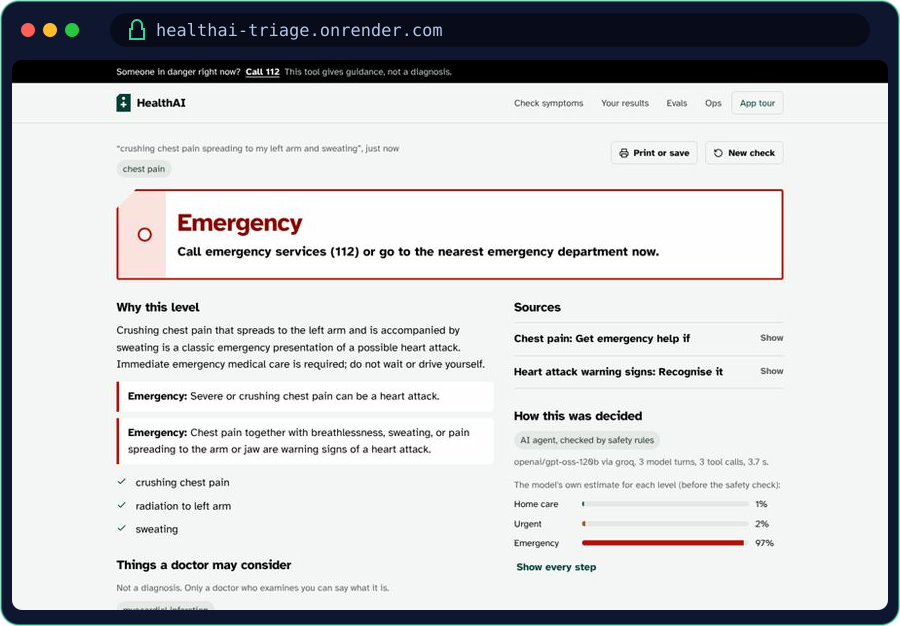
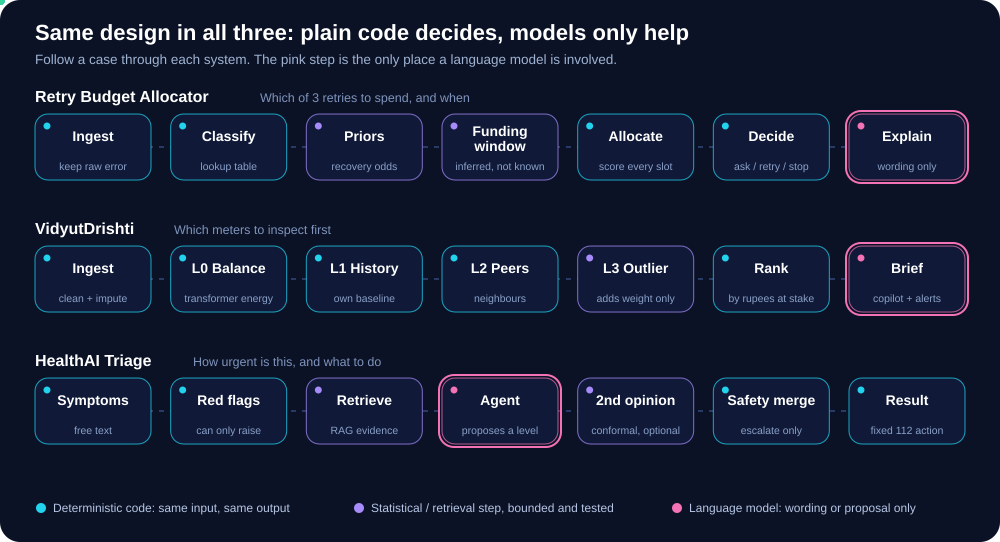
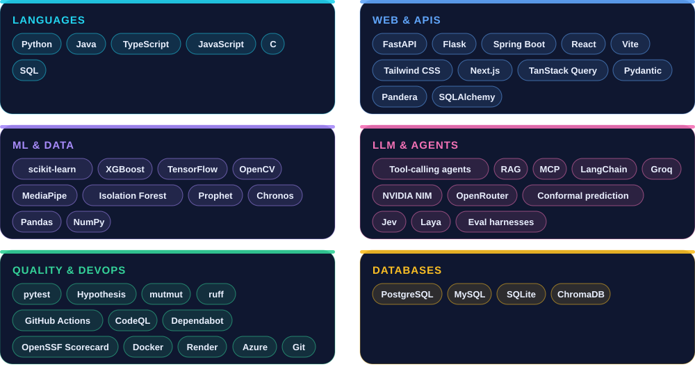

 

 

> **I build AI systems you can check, not just demo.** Every project below is deployed, has a test suite, a published evaluation and an honest write-up of what did not work. Models write the words; plain, tested code makes the decisions that have to be right.

 

## ⚡ By the numbers

Retry Budget Allocator numbers come from simulated payments under a stated outcome model, and VidyutDrishti's from simulated networks. They show how well each system decides, not real-world rates. Each repo's write-up says so.

 

## 🚀 Flagship projects

Each app is live and opens with a built-in guided tour of every page.

### 🔁 Retry Budget Allocator &nbsp;·&nbsp; spend 3 retries on purpose

<table><tr>
<td width="56%" valign="top">

</td>
<td width="44%" valign="top">

**In plain words:** when a UPI AutoPay payment fails, the rules allow three more tries. This works out *why* it failed, then asks the customer, retries at a legal time, or stops.

- **50% fewer attempts** (70 vs 141), **0 wasted**, **0 rule violations**
- Reports where it loses: 30 vs 35 recoveries; wins on money only above ₹147.82/attempt
- Decisions **deterministic, enforced by an AST test**; LLM writes wording only
- Pandera contract · **mutation testing 31/32** · 1,200+ property-based cases · CodeQL

 

</td></tr></table>

`Python` `FastAPI` `Pydantic` `Pandera` `React` `Tailwind` `mutmut` `Hypothesis` `GitHub Actions`

### ⚡ VidyutDrishti &nbsp;·&nbsp; find the meter hiding the missing energy

<table><tr>
<td width="44%" valign="top">

**In plain words:** compares what each transformer sends out with what its homes' meters record, then tells inspectors which homes to visit first, ranked by rupees at stake.

- **4 independent checks**: transformer balance, own history, peers, Isolation Forest
- **0.82 precision · 0.93 recall · F1 0.87** on 20 unseen networks, recall gated in CI
- Tool-calling **copilot** + **MCP server** over 8 read-only tools (**0 invented meter ids**)
- Checked against **real London smart-meter data** (realism 61% → 84%)

 

</td>
<td width="56%" valign="top">

</td>
</tr></table>

`Python` `FastAPI` `scikit-learn` `React` `TypeScript` `TanStack Query` `Groq` `NVIDIA NIM` `MCP`

### 🩺 HealthAI Triage &nbsp;·&nbsp; an agent that can never downgrade an emergency

<table><tr>
<td width="56%" valign="top">

</td>
<td width="44%" valign="top">

**In plain words:** describe your symptoms and get *home care*, *see a doctor today* or *emergency*, with reasons and sources. Fixed safety rules check every case and the most cautious answer always wins.

- Red-flag rules **can only raise a level**; final level = `max(rules, agent, conformal)`
- **60-case eval gated in CI**: 100% of red-flag cases, 85% of emergencies, 2 misses published
- Hybrid RAG, provider failover, Ops page, **135 tests** with no network

 

</td></tr></table>

`Python` `FastAPI` `React` `RAG` `Groq` `NVIDIA NIM` `Conformal prediction` `SQLite` `GitHub Actions`

 

## 🧠 One design, three systems

1. **Deterministic where it must be right.** Money, safety and rules are plain code with tests.
2. **Models where they add value.** Explaining, summarising and answering, always with a fallback.
3. **Prove it.** Evals, mutation tests, CI gates, and a "what did not work" section.

 

## 🔬 Research

 

## 🏆 Recognition & leadership

<b>Experience & programs</b>

 

| | |
|---|---|
| 💼 **AptPath** · AI/ML Development Intern · Jul – Aug 2025 | Built [YogaAlign](https://github.com/Asha0509/YogaAlign): MediaPipe landmarks → SVM and Random Forest classifiers for yoga poses from video and live camera |
| 🎓 **Ananya's Atlassian Mentorship** · DSA & Backend · Nov 2025 – May 2026 | 6-month mentorship in distributed system design, OOP and team Git workflows |
| 🌍 **Aspire Leaders Program** · Aspire Institute (Harvard-affiliated) | Global leadership development, completed March 2025 |

 

## 🛠️ Toolbox

<b>More projects</b>

 

- **[A2S – Aesthetics To Spaces](https://github.com/AestheticsToSpaces/A2S_Beta)** · [HyKr Build Challenge MVP](https://github.com/Asha0509/A2S-MVP-Hykr): AI interior design for homebuyers. Spring Boot backend (Spring Security + OAuth, JPA on PostgreSQL, cached catalog, rate limiting), Python AI service with image fallbacks, React + Three.js 3D walkthrough, Docker Compose. 28,000+ products.
- **[NexusDocs](https://github.com/Asha0509/Nexus_Docs)**: chat with your PDFs and notes; every answer cites its source passage. FastAPI, LangChain, ChromaDB, Next.js.
- **[YogaAlign](https://github.com/Asha0509/YogaAlign)**: yoga pose classification from video or webcam (AptPath internship). Flask, OpenCV, MediaPipe.
- **[Since](https://github.com/Asha0509/Groww_Hackathon)**: smart market watchlist, Code by Groww 2026 finalist project.
- **[Multi-tenant E-commerce API](https://github.com/Asha0509/Ecommerce_FullStack)**: Spring Boot + JPA backend with carts, orders and Stripe payment intents.

 

## 📊 GitHub

