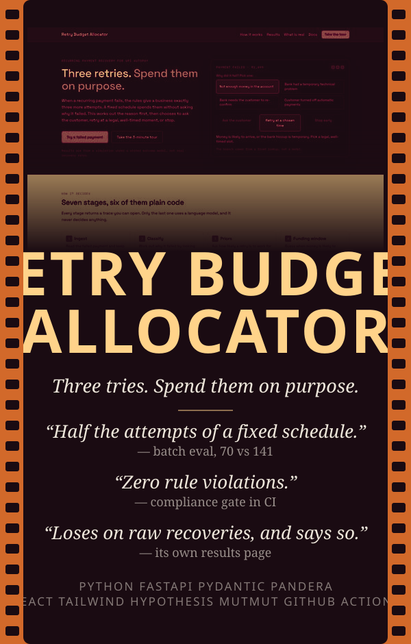
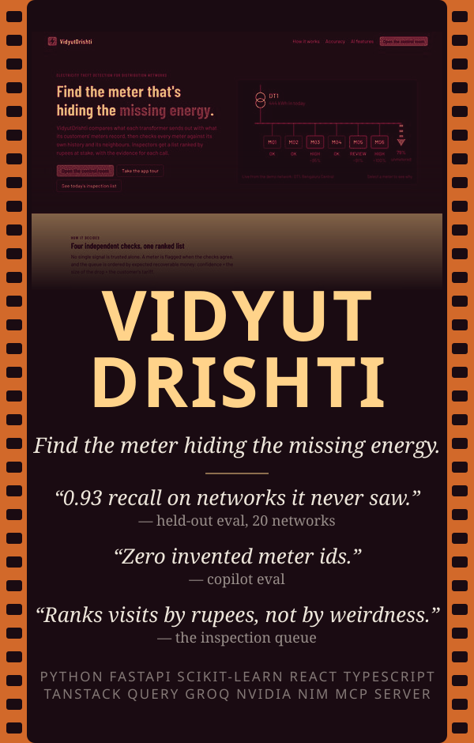
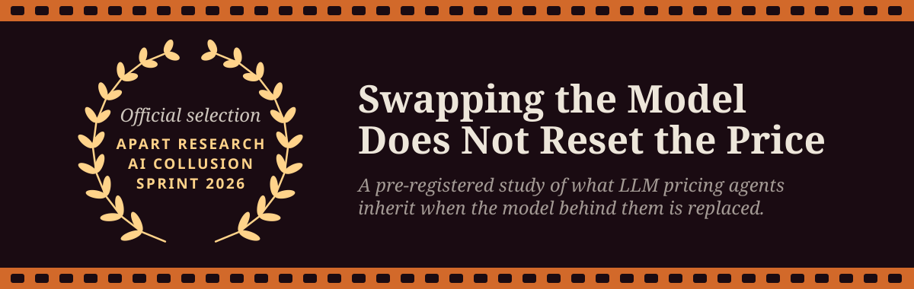

  

&nbsp;&nbsp;
&nbsp;&nbsp;

  

*B.Tech CS (AI & ML), BVRIT Hyderabad, 2023 to 2027, CGPA 8.80. Looking for AI/ML and SDE internships.*

 

## Now showing

Three systems, each live with a guided tour. In every one, plain tested code makes the decisions that have to be right, and a language model only does the talking.

<table>
<tr>
<td width="33%" valign="top" align="center">

 <a href="https://retry-allocator.onrender.com"><b>Watch it live</b></a> &nbsp;|&nbsp; <a href="https://github.com/Asha0509/retry-budget-allocator">Read the code</a>
</td>
<td width="33%" valign="top" align="center">

 <a href="https://vidyutdrishti.onrender.com"><b>Watch it live</b></a> &nbsp;|&nbsp; <a href="https://github.com/Asha0509/VidyutDrishti">Read the code</a>
</td>
<td width="33%" valign="top" align="center">

 <a href="https://healthai-triage.onrender.com"><b>Watch it live</b></a> &nbsp;|&nbsp; <a href="https://github.com/Asha0509/HealthCare">Read the code</a>
</td>
</tr>
</table>

<b>Synopses</b>

 

**Retry Budget Allocator.** When a UPI AutoPay debit fails, the rules allow three more tries. This decides how to spend them: ask the customer, retry at a legal time, or stop. It uses half the attempts of a fixed schedule (70 vs 141), wastes none and breaks no rules. It also reports where it loses: 30 vs 35 recoveries. Cause, timing and stop are deterministic and enforced by an AST test; the model only writes customer wording. Pandera data contract, mutation testing (31 of 32 mutants killed), 1,200+ property-based cases, CI gates.

**VidyutDrishti.** Finds likely electricity theft and ranks inspections by the money a visit would recover. Four independent checks (transformer balance, own history, neighbours, Isolation Forest) score 0.82 precision and 0.93 recall on 20 networks the detector never saw, with recall gated in CI. A tool-calling copilot and inspection-brief agent read only from data tools (0 invented meter ids), also served as an MCP server. The simulator was checked against real London smart-meter data.

**HealthAI Triage.** A symptom-triage agent over a RAG knowledge base, built so a model error can't make an emergency look safe. Red-flag rules can only raise the level. A 60-case eval runs in CI: rules alone catch every red-flag case and 85% of all emergencies, and the two misses are published. 135 tests run with no network.

Retry Budget Allocator results come from simulated payments under a stated outcome model, and VidyutDrishti's from simulated networks. They measure how well each system decides, not real-world rates, and each repo says so.

 

## The rule in every script

1. **Act one: decide with code.** Money, safety and compliance are plain, deterministic code with tests.
2. **Act two: let models talk.** Language models explain, summarise and answer, always with a fallback when they fail.
3. **Act three: prove it.** Evals in CI, mutation tests, and a published section on what did not work.

 

## Official selection

When a pricing agent's model is replaced, prices don't reset. With the old agent's notes, the new model starts at exactly the old price in 18 of 18 markets; without them, it takes about 16 rounds to settle. The notes contain no collusive language, so a monitor scanning agent memory would miss this channel. [Read the study](https://github.com/Asha0509/Apart-AI-Collusion-Research-Sprint).

 

## Previously

**AptPath**, AI/ML development intern, July to August 2025. Built [YogaAlign](https://github.com/Asha0509/YogaAlign): MediaPipe landmarks feed SVM and Random Forest classifiers that name 6 yoga asanas from video or a live webcam, with accounts and saved results.

**Ananya's Atlassian Mentorship Program**, DSA and backend track, November 2025 to May 2026. Six months of mentored work on distributed system design, OOP and team Git workflows.

 

## Awards season

- **Code by Groww 2026**, finalist, one of 9 finalists, with [Since](https://github.com/Asha0509/Groww_Hackathon), a smart market watchlist
- **Flipkart GRiD 8.0**, Round 3 qualifier, top 0.5% of 400,000+ applicants
- **CodeChef 3-star**, 850+ problems solved across LeetCode, CodeChef and Codeforces
- **ICIARD 2024, Thailand**, presented *Significance of Emergent Technologies in Teaching Learning Processes*
- **A.S.P.I.R.E**, co-founder and joint secretary of BVRIT Hyderabad's first student-led AI/ML club: 9 events, workshops for 100+ students, a 200+ participant inter-college competition
- **Aspire Leaders Program**, Aspire Institute (Harvard-affiliated), completed March 2025
- **SAP Hackfest 2024**, semifinalist

 

## Also playing

- **[NexusDocs](https://github.com/Asha0509/Nexus_Docs)**: chat with your PDFs, Word and Markdown files, with every answer citing its source passage. Local embeddings in ChromaDB, folder-scoped retrieval, any OpenAI-compatible model.
- **[A2S, Aesthetics To Spaces](https://github.com/AestheticsToSpaces/A2S_Beta)**: AI interior-design platform. React, Spring Boot and a Python LLM service, 28,000+ products from 7 scrapers, a Gemini multi-agent system, Docker and Azure CI/CD.
- **[Multi-tenant e-commerce API](https://github.com/Asha0509/Ecommerce_FullStack)**: Spring Boot and JPA backend for a multi-seller store with carts, orders and Stripe payment intents.

 

## Credits

<b>Where each skill shows up</b>

 

| Area | Skills | Proof |
|---|---|---|
| Backend and APIs | Python (FastAPI, Flask, Pydantic), Java (Spring Boot, Spring Data JPA), REST design | [Retry Allocator](https://github.com/Asha0509/retry-budget-allocator), [VidyutDrishti](https://github.com/Asha0509/VidyutDrishti), [HealthAI](https://github.com/Asha0509/HealthCare), [E-commerce API](https://github.com/Asha0509/Ecommerce_FullStack) |
| Models, RAG and agents | Tool-calling agents, RAG with citations, MCP server, provider failover, eval harnesses | [HealthAI](https://github.com/Asha0509/HealthCare), [VidyutDrishti](https://github.com/Asha0509/VidyutDrishti), [NexusDocs](https://github.com/Asha0509/Nexus_Docs) |
| Machine learning and vision | scikit-learn, Isolation Forest, conformal prediction, forecasting, MediaPipe, OpenCV | [VidyutDrishti](https://github.com/Asha0509/VidyutDrishti), [HealthAI](https://github.com/Asha0509/HealthCare), [YogaAlign](https://github.com/Asha0509/YogaAlign) |
| Data | SQL, PostgreSQL and TimescaleDB, MySQL, SQLite, ChromaDB, Pandas, Pandera data contracts | [VidyutDrishti](https://github.com/Asha0509/VidyutDrishti), [Retry Allocator](https://github.com/Asha0509/retry-budget-allocator), [NexusDocs](https://github.com/Asha0509/Nexus_Docs) |
| Testing and quality | pytest, Hypothesis property tests, mutation testing (mutmut), CI eval gates, CodeQL | [Retry Allocator](https://github.com/Asha0509/retry-budget-allocator), [HealthAI](https://github.com/Asha0509/HealthCare), [VidyutDrishti](https://github.com/Asha0509/VidyutDrishti) |
| Frontend | React, TypeScript, Next.js, Tailwind CSS, TanStack Query | [VidyutDrishti](https://github.com/Asha0509/VidyutDrishti), [NexusDocs](https://github.com/Asha0509/Nexus_Docs), [Retry Allocator](https://github.com/Asha0509/retry-budget-allocator) |
| Shipping | GitHub Actions, CodeQL, Dependabot, OpenSSF Scorecard, Render, Docker | All three flagship repos (Docker in [VidyutDrishti](https://github.com/Asha0509/VidyutDrishti)) |
| Research | Pre-registered experiments, multi-agent LLM simulation, honest negative results | [AI Collusion sprint](https://github.com/Asha0509/Apart-AI-Collusion-Research-Sprint) |

 

&nbsp;&nbsp;
&nbsp;&nbsp;

